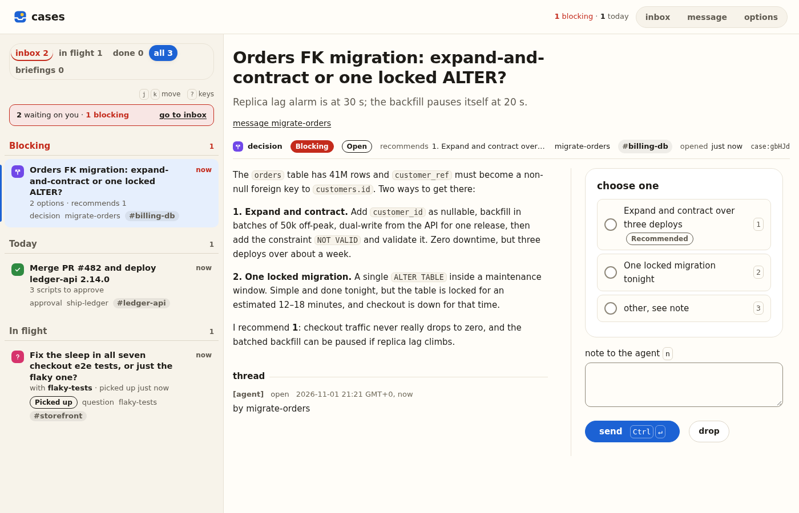

# cases

`cases` is a CLI for passing questions from a coding agent to a human and getting the answer back. The question is called a case.

1. The agent opens a case: a decision to make, scripts to approve, work to sign off, a blocker, a question, or something the human should know.
2. The agent waits in the background.
3. The human answers from the terminal or from a local web inbox (`cases serve`).
4. The agent picks up the answer, acts on it, and closes the case with what happened.

The cases live in one SQLite file on this machine, and every event is kept as it was written. No server is needed.

<picture>
  <source media="(prefers-color-scheme: dark)" srcset="docs/images/inbox-dark.png">
  
</picture>

**Pre-release.** Releases are alpha builds for now.

## Why

A coding agent that needs a decision usually asks in its terminal and stops until someone reads it. With a few agents running, the questions are spread across terminals, and an agent can wait for hours on a question nobody has seen. When the session ends, the question and its answer go with it.

cases gives every agent one place to put its questions, lets the human answer them in one inbox, and keeps each question, answer and outcome as a record.

## Install

Each release has a `cases` binary for macOS (arm64, x86_64) and Linux (static, x86_64, aarch64).

Pick the target for the machine: `aarch64-apple-darwin`, `x86_64-apple-darwin`, `x86_64-unknown-linux-musl` or `aarch64-unknown-linux-musl`.

```sh
version=0.0.1-alpha.1
target=aarch64-apple-darwin
cd "$(mktemp -d)"
gh release download "v$version" --repo ryanlewis/cases \
  --pattern "cases-$version-$target.tar.gz" --pattern SHA256SUMS
shasum -a 256 -c --ignore-missing SHA256SUMS &&
  mkdir -p ~/.local/bin &&
  tar -xzf "cases-$version-$target.tar.gz" -C ~/.local/bin cases &&
  cases --version
```

The `&&`s stop the install if the checksum does not match. On a Linux without `shasum` (it comes with perl), use `sha256sum -c --ignore-missing SHA256SUMS` instead. `~/.local/bin` must be on `PATH`. The macOS binaries are not notarised: a binary downloaded by `gh` runs, but one downloaded in a browser is quarantined until `xattr -d com.apple.quarantine ~/.local/bin/cases`.

### From source

With the Rust toolchain from `rust-toolchain.toml` (rustup installs it on the first build):

```sh
git clone git@github.com:ryanlewis/cases.git
cd cases
cargo install --locked --path crates/cli
```

This puts `cases` in `~/.cargo/bin`. The binary includes SQLite and the web inbox; nothing else needs installing, and the build does not need node.

Either way, install the agent skill next. It teaches the agent when to open a case, how to wait for the answer and how to act on it:

```sh
cases skill install claude    # also: codex, pi
```

## A first case

This runs one case end to end in the default store, `~/.local/share/cases/cases.db`. In real use an agent runs the agent's commands; to try it, run both sides in one shell.

```sh
# Agent: open a decision and wait for the answer in the background.
echo "Pin bun to 1.2.3, or float it and fix the lockfile when it breaks?" > question.md
id=$(cases open --kind decision --urgency blocking --title "Pin bun or float?" \
  --body-file question.md --option "Pin to 1.2.3" --option "Float and fix the lockfile" \
  --recommend 1)
# --since "$id" stops wait missing an answer that lands before it starts.
cases wait --id "$id" --since "$id" --timeout 2h > answered.jsonl &

# Human: answer it, from here or from the web inbox.
cases answer "$id" --option 1 --note "Revisit after 1.3"

# Agent: record that the answer was read, act on it, and close with the outcome.
# (wait --pickup --by NAME records the pickup itself.)
cases pickup "$id" --by bun-pins
cases close "$id" --outcome "Pinned in #12."
cases show "$id"
```

A case id is a short code such as `UkLWZ`. `list`, `show` and the inbox print it with a slug of the title after it, such as `UkLWZ-pin-bun-or-float`; every command ignores the slug.

## Kinds

| Kind | For | The human answers with |
| --- | --- | --- |
| `decision` | choosing between options | an option, which the agent may recommend, or "other" with a note |
| `approval` | running scripts or gated actions | approve, hold or reject for each row |
| `signoff` | finished work that needs accepting | accept, or changes with a note |
| `stuck` | a blocked agent | guidance, or park the case until later |
| `question` | a question answered in words | a reply |
| `fyi` | something the human should know | an acknowledgement |
| `briefing` | finished work, shown as a short document | accept, or send back with a reason, and file any of what it left out |

Any case can also be dropped, which tells the agent to stop the work. Urgency is `blocking`, `today` or `whenever`, and orders the inbox.

## The web inbox

`cases serve` runs a web inbox over the store at `http://127.0.0.1:7337/` and opens it in the browser. It only listens on loopback.

- One list, with filters: the inbox (open and parked cases, grouped by urgency), in flight (answered and picked up), done, and all. Each card says what the case asks.
- The selected case shows its body as markdown, its properties, its thread, and a form that fits its kind.
- The page follows the store: a new case, a note or an amend shows up without a reload.
- If the question changes while you are answering it, the send is refused and the case is shown again, so you do not answer a question you have not read.
- `j` and `k` move through the list, `1` to `9` choose an option, Cmd+Enter or Ctrl+Enter sends, and `?` lists the keys. Hints show each key where it works.
- The options dialog sets the look (daylight, mono or keel), the theme, the font and text size, where links open, the key hints, and desktop notifications for new cases.
- On a narrow window, such as a phone's, it shows one column.

`cases status` says where serve is running, and `cases inbox [ID]` opens it, or one case in it.

To reach the inbox from your other devices over Tailscale, put it behind `tailscale serve`, which serves it over HTTPS on the tailnet only, and name that host in the config file:

```
tailscale serve --bg --https=7337 http://127.0.0.1:7337
```

```toml
# ~/.config/cases/config.toml
allow-hosts = ["devbox.example.ts.net:7337"]  # host[:port] as the browser sends it; leave out :443
tailscale-logins = ["you@github"]           # optional: only these Tailscale users
```

Serve still listens only on loopback. Without `allow-hosts` it refuses any other Host, so a rebound DNS name cannot read it. A write through an allowed host must come from `https://` that host, and still carries the inbox's token. With `tailscale-logins` set, a request through an allowed host is refused unless its `Tailscale-User-Login` header, which `tailscale serve` sets for a tailnet user (a tagged device sends none), is one of them. Anything that can reach `127.0.0.1:7337` directly can send that header too, so it only means something because serve is on loopback. A request made straight to the loopback address needs no login; one that came through `tailscale serve`, which always sets `X-Forwarded-Host`, needs one whatever its Host. Serve reads both at start: restart it, or the service, after changing them.

With `allow-hosts` set, the links cases gives name the first entry over HTTPS, such as `https://devbox.example.ts.net:7337/cases/UkLWZ-pin-bun`, so that one opened on another device reaches the inbox: put the tailnet name first. Links are the `url` of `cases show` and the API, `cases inbox --print`, and the case in a notification; plain `cases inbox` still opens the loopback address on this machine. `cases status` still gives the loopback address serve listens on, and the instance file records both (`url` and `link`). A command on a forwarded store gives the far side's link, when a serve there has one. Serve refuses any request `tailscale funnel` passes on (it carries `Tailscale-Funnel-Request`), so the inbox is never served to the internet.

To keep the inbox running, `cases service install` sets `cases serve` up as a user service that starts at login: launchd on macOS (`sh.cases.serve`), systemd on Linux (`cases-serve.service`). Plain `cases service` reports whether it is installed, loaded and answering.

## The terminal inbox

`cases tui` shows the inbox in the terminal: the list of cases on the left and the selected case on the right, with the same filters as the web inbox. It reads the store again every second.

- `j` and `k` move through the list, `l` reads the case and Esc goes back, `[` and `]` change the filter, Space scrolls the case, and `?` lists the keys. The footer starts with where the keys are and where Tab takes them next.
- The answer is at the foot of the case. A number answers the selected case from the list: a decision's option, a signoff's or a briefing's 1 to accept and 2 for changes or to send it back, an approval's row. `n` writes the note, and Enter or Tab goes into the answer, as `a` does. In it, Tab moves through its parts and back to the list, its buttons being one stop that Left and Right move along, and Enter sends or presses the button; Shift+Enter, where the terminal reports it, or Alt+Enter adds a line. `p` parks a stuck case, `r` resumes a parked one, and `w` withdraws an answered one from its agent. Ctrl+E writes a reply or note in `$VISUAL` or `$EDITOR`. On an approval, `j` and `k` move between rows and `y`, `h` and `x` approve, hold or reject each one.
- As in the web inbox, a send made against an older version of the case is refused, and the form keeps what you typed.
- `m` writes a message to an agent session: pick one of the sessions listening now with a number, or type a worker name or `#label`. `e` edits a message no agent has picked up yet, and `w` takes one back.
- The case shows its body as markdown, its options or rows, the answer, the outcome and the thread.
- On a narrow terminal it shows one pane at a time.
- A strip under the filters shows the cases opened and answered on each of the last 14 days (UTC) and the median time to answer. `s` hides or shows it, and it hides itself on a terminal under 24 rows. `tui-stats = "off"` in the config file starts with it hidden. Where the terminal draws kitty graphics, as kitty, Ghostty and Rex do, the strip is a small bar chart; elsewhere it is text, and `tui-stats = "text"` keeps it text.
- Inside [herdr](https://herdr.dev), the pane shows as blocked while cases wait on you.

## The agent skill

The skill is a `SKILL.md` built into the binary, so it always matches the commands the binary has. It is written for an agent: the lifecycle, the kinds and their answers, the exit codes, what not to do, and the open, wait and close recipe. What an agent needs only now and then, such as `amend` or every flag of `open`, is in a reference the agent prints with `cases skill show --reference [TOPIC]`, so the skill it keeps loaded is short.

```sh
cases skill install claude   # also: codex, pi
cases skill list             # each agent, where the skill goes, and whether it is installed
cases skill check            # exit 1 if an installed skill differs from this binary
cases skill show             # print it
```

After upgrading `cases`, run `cases skill install` again.

## Configuration

The store is `--store FILE`, then `$CASES_STORE`, then the config file's `store`, then `~/.local/share/cases/cases.db` (or under `$XDG_DATA_HOME`). The config file, `~/.config/cases/config.toml` by default, supplies defaults for flags such as the store, serve's address and the name answers are written as. `cases config init` writes a commented template, and `cases config show` prints what is in use.

An agent closes its briefings once it has acted on the answer. `cases serve` closes any briefing left picked up for longer than the config file's `briefing-close-after`, `7d` by default, as expired, with an outcome that says why, such as "closed after 7 days picked up". It checks when it starts and each hour after. The close wakes no agent's wait. `briefing-close-after = "off"` turns it off. `cases sweep --stale-briefings` does the same by hand, and only prints what it would close until given `--yes`. Durations here and in flags take `d` for days, as well as `h`, `m` and `s`.

### One store from several machines

A store can live on one machine and be used from others over ssh. Set `forward = "ssh://host"` in the config file, or `$CASES_FORWARD`, and every command sends its store calls to the store on that host: it runs `ssh host cases dial-stdio`, which opens the store there, and speaks to it over the pipe. Auth is your ssh keys and config; nothing listens on the network. ssh runs with `BatchMode=yes`, so it never prompts: a password, a key's passphrase or a host key not yet known fails the command. Use a key (an ssh agent is fine), and ssh to the host once to accept its key. `cases` must be on the PATH of a non-interactive shell on the host. `$CASES_FORWARD` comes before `$CASES_STORE`, the config file's `forward` before its `store`, and `--store` before both; `--store ssh://host` forwards one command. The web inbox and `cases serve` run on the host, where the store is. When serve there has `allow-hosts`, a forwarded `cases show` and `cases inbox --print` give its link, so a case's page opens from here; without it they give none. `cases sweep --stale-briefings` is refused on a forwarded store: the age is the host's `briefing-close-after`, and serve on the host closes stale briefings each hour, so run it there.

To reach the store some other way, give the whole command that runs `cases dial-stdio` next to it, after `exec:`: `forward = "exec:docker exec -i box cases dial-stdio"`, or `kubectl exec -i pod -- cases dial-stdio`, or an ssh with options of your own. cases runs it with `sh -c`, so quote as at a shell, and speaks to it over its stdin and stdout as it does to ssh. The command must not prompt or write anything else to stdout. `--store exec:<command>` forwards one command.

To skip ssh between machines on a tailnet, forward over HTTP to `cases serve` on the host instead. It answers the store routes next to the inbox. On the host, put serve behind `tailscale serve` on a port of its own over plain HTTP, which WireGuard encrypts on the tailnet, and on the other machine point the forward at it:

```sh
# on devbox, next to the inbox's https proxy
tailscale serve --bg --http=7338 http://127.0.0.1:7337
```

```toml
# ~/.config/cases/config.toml on the other machine
forward = "http://devbox.example.ts.net:7338"
forward-token-file = "~/.config/cases/forward-token"  # optional, see below
```

A store route straight to serve's loopback address needs nothing, as the inbox does not. One through the proxy, which sets `X-Forwarded-Host`, or by a Host of `allow-hosts`, is let in only with a token of serve's `store-tokens-file` as its bearer token (`forward-token-file`, or `$CASES_FORWARD_TOKEN_FILE`, on the other machine), or from a Tailscale login in serve's `tailscale-logins`. A tagged device has no login, so a token is its way in. Each token file holds tokens one to a line (blank lines and `#` comments skipped), at least 32 letters, digits and `-._~+/=`, such as `openssl rand -hex 32` gives; keep them private (`chmod 600`). Tokens are compared in constant time and never logged. With neither set, nothing gets in through the proxy. A request `tailscale funnel` passes on is refused, and so is any a browser sends (it carries `Origin` or `Sec-Fetch-Site`), so no page can reach the store routes; the inbox's own checks are as before. Plain HTTP is fine here, unlike the inbox's writes, which must come from `https://` for the browser's origin check: the store routes have no browser and no cookie, and each request names who it is from. Use plain HTTP only over a tailnet: elsewhere the token would go in the clear. `https://` needs a build with the `remote` feature, which a release leaves out. A `wait --pickup` holds its locks on the host on a 30 s lease by an id, renewed every 10 s and let go when the wait ends, since a proxy keeps no connection for it. `forward = "http://…"` is read from the config file and `$CASES_FORWARD` alone: `--store https://host/<name>` is still a hosted store.

A `wait --pickup` on a forwarded store holds its locks on the far side. Ctrl-C, SIGTERM and SIGHUP let them go before the wait ends, and name on stderr any case it had picked up and not printed yet, one line each, in this form, so that a script around it can find them: `warning: <id>: picked up, but not printed: a signal ended the wait`. On Linux, a signal the wait was started with ignored, as `nohup` ignores SIGHUP, stays ignored. Elsewhere SIGHUP is not caught at all, so `nohup` works, but a closed terminal leaves the locks until their lease runs out; an ignored SIGINT or SIGTERM is caught there as any other.

Every command documents its flags in `cases <command> --help`.

## Layout

- `crates/core`: `cases-core`, the pure core: event replay, transition rules and answer validation. It has no IO and reads no clock. It is published as its own crate.
- `crates/id`: `cases-id`, case ids: the Sqids encoding of a case's numeric key. It is published like the core.
- `crates/store-sqlite`: the store in one SQLite file, with the actors table, the archive and the poller that `wait` and the inbox use.
- `crates/cli`: the `cases` binary and the web inbox. The inbox is a Preact app written in TypeScript; `build.rs` strips the types with oxc, and the result is embedded in the binary.
- `spec/vectors/`: the core's contract as JSON vectors. `README.md` there describes the format, and `CHANGES.md` records every change to a rule.
- `crates/cli/STORIES.md` maps each user story's criteria to the tests that cover them.

## Development

```sh
cargo fmt --all
cargo clippy --workspace --all-targets --locked -- -D warnings
cargo test --workspace --locked
RUSTDOCFLAGS="-D warnings" cargo doc --workspace --no-deps --locked
cargo deny check
cargo mutants -p cases-core -p cases-id -p cases-store-sqlite
.github/scripts/semver-check.sh origin/main
.github/scripts/check-vector-changes.py origin/main
(cd crates/cli/src/commands/serve/web && npm ci --ignore-scripts && npx tsc --noEmit -p tsconfig.json && npm test)
```

The tools come from `cargo install --locked cargo-deny cargo-mutants cargo-semver-checks`. CI runs all of them:

- `cargo deny check` checks advisories, licences and sources against `deny.toml`.
- `cargo mutants` changes the code of the core, the ids and the store in small ways and expects a test to fail each time. A pull request mutates only the code it changes; the full run is weekly. Exclusions, each with its reason, are in `.cargo/mutants.toml`.
- `semver-check.sh` compares the public APIs of `cases-core` and `cases-id` with the base. A breaking change fails until the PR bumps the crate's version.
- `check-vector-changes.py` refuses a change to `spec/vectors/` without a line in `CHANGES.md`.
- The last line type-checks the inbox's TypeScript and runs its tests. npm is used only for this check, never for the build.

## License

MIT
