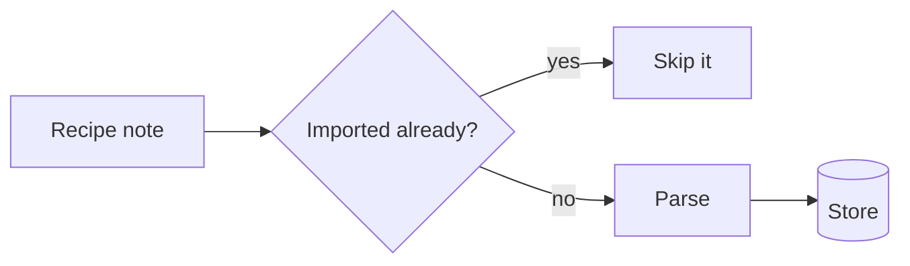

# cases — reference

The parts of the skill an agent needs only now and then. Print one with `cases skill show --reference TOPIC`, where TOPIC is the first word of its heading: `kinds`, `open`, `amend`, `briefing`, `wait`, `show`, `list`, `status`, `doing`, `drawing`, `store` or `mod`.

## kinds — each kind's answer, and approval rows

| Kind | Use it for | Open with | The answer (`answer` in `wait` lines and `show --answer`) |
| --- | --- | --- | --- |
| `decision` | Choosing between options | `--option TEXT`, one per option (at least one), and `--recommend N` for the one you recommend | `choice`: the 1-based option number. Or `other: true` with the human's `note`. "Other, see note" is always offered, so do not add it. The human may choose any option, not only the one you recommend. |
| `approval` | Running scripts or gated actions | `--row JSON`, one per row (at least one) | `rows`: one `{id, verdict, note}` per row. `verdict` is `approve`, `hold` or `reject`. |
| `signoff` | Finished work that needs accepting | | `signoff`: `accept`, or `changes` with a `note` |
| `stuck` | You are blocked and need guidance | | `text` (guidance). The human may park the case instead of answering. |
| `question` | A question the human answers in their own words, not by picking an option | | `text` (the reply) |
| `fyi` | Something the human should know; you are not blocked | | `ack: true` |
| `briefing` | A finished piece of work to show the human | A body, which it requires, `--landed` if the work has landed, and `--left-out TEXT`, one per item left out on purpose | `briefing`: `accept`, or `send_back` with the human's `note`, the reason. `file`: the `left_out` items to file, by number from 1, with either verdict; it may be empty. |

Any kind may instead come back `drop: true`, with nothing else set but the `note`: the human does not want the work done. Any answer may carry a `note`; it often narrows or conditions the choice. An eighth kind, `message`, is the human's: you never open one.

An approval row is a JSON object with four non-empty fields. The `id` may use letters, digits, `.`, `-` and `_`, and must be unique in the case. `script` is the text itself, so it can be read on a phone, and `link` points at where it lives. The web inbox makes a `link` clickable when it is an absolute address, such as `https://…`, `mailto:…` or `obsidian://…`, but not `javascript:`, `data:` or `file:`; a relative path is shown as text. An optional `note` is shown under the label, drawn as inline markdown (links, `code` and emphasis); use it for what the human should know before approving, such as a side effect. When a row acts on a PR, an issue or a page, give its URL as the row's `link`, or as a markdown link in the note, so the human can open it; a script's path then goes in the note. A field the row does not have is refused, so a misspelt one is not lost:

```sh
--row '{"id":"deps","label":"Install deps","script":"npm ci","link":"https://github.com/o/r/blob/main/setup.sh"}'
```

Add `"by":"human"` to a row for a step only the human can carry out, such as one in a console you cannot reach. Its `script` says the step, in words or as commands for the human to run, and its `link` points at where to do it. The inbox marks the row as the human's, and its approve reads "done": on such a row, `approve` means the human has done the step, so do not run it, and `hold` or `reject` mean it is not done. Leave `by` out for a row you run; `human` is the only value it takes:

```sh
--row '{"id":"dns","label":"Point DNS","script":"Point release.example.com at the new host","link":"https://dash.example.com/dns","by":"human"}'
```

## open — every flag

```sh
cases open --kind KIND --urgency blocking|today|whenever --title TEXT \
  [--body TEXT | --body-file FILE|-] [--option TEXT]... [--recommend N] [--row JSON]... \
  [--landed] [--left-out TEXT]... [--link URL]... [--label TEXT]... [--worker NAME] [--brief TEXT] \
  [--context TEXT] [--for NAME] [--re ID] [--json | --wait [--timeout D]]
```

- `--recommend N` names the option you recommend, by its number from 1. The web inbox and `show` mark it, and `show --json` gives it as `recommend`. Use it instead of a `Recommendation:` line in the body, and keep your reasons in the body. It must name one of the options; "Other, see note" is not one.
- When the options have a natural order, such as the order the body lists them in, give them in that order, so option N is the body's N: the inbox's number keys choose by that number. Do not move your pick first, number the option text or write "(recommended)" into it; `open` and `amend` warn on stderr of an option that does.
- `--option` and `--recommend` are for `decision` only and `--row` for `approval` only; they are refused on any other kind. The same option twice is refused.
- `--landed` and `--left-out TEXT` are for `briefing` only. A briefing takes up to 10 left-out items, each at most 300 characters, none repeated, and a body that is not blank. See the `briefing` topic.
- `--link URL` (repeatable) for the PR, issue or file the human should look at. `--label TEXT` (repeatable) groups the case with others; `list` and `wait` filter by it. A blank link or label, or the same one twice, is refused.
- `CASES_WORKER` and `CASES_LABEL`, if exported, stand in for `--worker` and one `--label` on `open`. `CASES_LABEL` is one label, commas included; an empty one counts as not set. Any `--label` flag replaces it. `wait` and `list` do not read them, so still pass `--label` or `--worker` there.
- `--worker NAME` names your session, the one that waits on the case and picks it up. Opening a case on another's behalf, such as a lead's for its worker, still gives your own name; name the other in `--context`. `--brief TEXT` says where to restart from if the case is parked: a brief, a ledger or a note. `--context TEXT` is free text shown to the human with the case. `--for NAME` names the human the case is addressed to, when you were told who should answer. A worker, brief or context of only white space is refused.
- `--re ID` names the case this one is about, by its whole id, such as a message from the human that left you with a question. The inbox shows the link both ways. An id not in the store is refused.
- Your events record you as their `actor`: one actor per worker name, or one unnamed agent when you give no worker. An answer records the human's actor too; it changes nothing about what the answer means.
- Prints the new case id. `--json` prints its `id`, `state` and `revision` instead.
- `--wait` then waits on the case, as `cases wait --id ID --since ID --pickup --by WORKER` does, with your `--worker` (or no name, without one): the id comes first, flushed, and the case's line follows once it is your turn, picked up when answered. `--timeout D` gives up after D with exit 2, the id already printed; it needs `--wait`. `--wait` refuses `--json`, and a config file whose `mood` the wait would refuse, before it opens the case.

## amend — change a case, or reopen it

```sh
cases amend ID [--title TEXT] [--body TEXT | --body-file FILE|-] [--option TEXT]... [--recommend N] \
  [--row JSON]... [--landed | --not-landed] [--left-out TEXT]... [--link URL]... [--drop-link URL]... \
  [--label TEXT]... [--context TEXT] [--reopen] [--revision N] [--json]
```

- Changes an open case before the human answers it: another option, another script to approve, a link, or a title, body or context that is wrong or out of date. The answer is checked against the case as amended, so an approval answer covers the rows you add.
- With `--reopen`, it changes an `answered` or `pickedup` case and reopens it, as `note --reopen` does: the case goes back to `open`, its answer and pickup are cleared, and the human answers the case as amended. The old answer stays in the thread. Without `--reopen` such a case is refused (exit 3); with it, an open case is refused. Use it after a signoff comes back `changes`: make them, then one `amend --reopen` that points the case at the new work, rather than closing the case and opening another.
- `--option` adds options to a `decision` case, numbered after the ones it has. `--row` adds rows to an `approval` case; each `id` must be new to the case. `--link` adds links and `--label` adds labels. `--drop-link URL` takes a link off the case, spelt exactly as the case has it; a link the case does not have, or one the same amend adds, is refused. An option, link or label the case already has is refused, and so is an amend that changes nothing, so the same amend sent twice writes nothing the second time. `--reopen` alone changes nothing: say what changed.
- `--title` replaces the title. `--body` or `--body-file` replaces the whole body, so write all of it, not only what changed. `--context` replaces the context.
- On a briefing, `--landed` or `--not-landed` changes whether the work has landed, and `--left-out` replaces the whole list of left-out items with the ones given. A briefing's body cannot be made blank.
- `--recommend N` changes the option you recommend, and may name an option the same amend adds. It can be changed but not taken away.
- An amend that changes the question (the body, another option or row, or a briefing's left-out items) moves the case's `amend_seq`. An answer the human wrote before it saw that amend is refused, so the answer you get is always to the question as it stands. The title, links, labels, context, the recommendation and a briefing's `--landed` or `--not-landed` do not move it; when you change your recommendation, give the reason in the body in the same amend.
- An amend erases nothing: the title, body, context and links it replaces or drops stay in the store and the thread. If a case holds a secret, amending it out does not remove it; tell the human so they can rotate it.
- Only links can be dropped; nothing else can be removed or reordered. If the question itself has changed, rather than the work it is about, withdraw the case and open a new one.
- Put every change in one amend: each one can send the human back to read the case. To add to the thread without changing the case, use `note`.
- An amend does not wake `wait`; leave your wait running.

## briefing — the body, with an example

A briefing's body is markdown, read top to bottom as one document. The parts, in order:

1. Heads-up: only for a surprise, said first. Leave it out otherwise.
2. Lead-in: one or two sentences leading into the view.
3. The view: the figure that explains the change fastest. A code excerpt, a table, a mermaid chart, or a before and after as a `diff` block or two code blocks. None for a tiny change. Put what you would say about a line of code in a comment on it.
4. Its caption: what to notice in the view. Always with a view.
5. The closing: a closing line, then "Decided for you: …" for each reversible choice you made without asking, at most three lines in all.
6. Then the checks, as short headed parts: the evidence (what ran, and the commit it ran on), the undo (easy or hard, and how), and what it affects.

Cases does not check the headings; the human reads them. Keep to plain words. What you left out goes in `--left-out`, not the body. The title is the headline, so the body does not repeat it. After a rebase or a fix, run the checks again and write the new commit, or the evidence is stale.

A real briefing usually has one view. This example has one of each kind, each with its caption, only to show them. A landed briefing for a recipe importer, opened with `--landed`, `--left-out "Unit conversion for ingredients"` and `--left-out "A dry-run flag"`:

````markdown
`recipe-box import` reads each recipe note in the vault and adds it to the store, skipping notes it has already imported.

```rust
// src/import.rs
let slug = slug_of(&note.path);
if store.has(&slug)? {
    // a second run changes nothing
    skipped += 1;
    continue;
}
// a note that does not parse stops the run, naming the file
store.add(parse(&note)?)?;
```

The slug check is what makes the import safe to run again.



Every note goes through the same check, so a run can be stopped and started again.

| Run | Notes read | Added | Skipped |
| --- | --- | --- | --- |
| First | 52 | 52 | 0 |
| Second | 52 | 0 | 52 |

The second run over the vault added nothing.

The help text before and after:

```diff
-  import   Import one recipe file
+  import   Import every recipe note in the vault, skipping ones already imported
```

The command keeps its name, so scripts that call it still work.

The import is one new command; nothing else changes.

Decided for you: a note that does not parse stops the run rather than being skipped, so nothing is lost silently.

**Evidence** (on `4e1d9a2`)

- `cargo test`: 38 passed, 4 new for the importer.
- Imported the 52 vault recipes into a temp store; a second run added 0.

**Undo** (easy): revert the one commit; the store keeps what it imported.

**Affects**: the CLI only; the app reads the store as before.
````

## wait — filters, timeouts and what a line holds

```sh
cases wait [--pickup [--by NAME]] [--since TIME|ID] [--timeout DURATION] [--id ID]... \
  [--kind KIND]... [--label TEXT]... [--worker NAME]... [--for agent|human] [--doing TEXT] [--full] \
  [--mood eager|steady|patient]
```

- A line has the case's `id`, `state`, `kind`, `title`, `revision` and `amend_seq`; the `answer` when there is one; the `park` while it is parked, whose `note` says why or until when; the `withdraw` once it is withdrawn, whose `reason` may say what to do instead; and `fresh` and `next_since`. A briefing's line also has its `landed`, and its `left_out` when it has any, so you can read the items the answer's `file` numbers. A message's line also has its `urgency`, `body`, `context`, `links`, and `re` when it is about a case. `--full` prints each case whole instead, as `show --json` does without `url`, which is long for a long body.
- `--pickup` picks up every answered case that matches, so scope it to your own: `--id`, or `--label` with `--worker` set to your session name; without one of them it is refused. No later `wait` prints a case it picked up, unless the human withdraws it: then `wait` prints it once more, as `withdrawn`.
- Only one `--pickup` wait at a time runs on each `--worker`, on each `--id`, and, for waits without `--worker`, on each `--label`, on one local store. A second exits 1 at once, naming the first wait's process and when it started: read that wait's output instead. The first lets go when it exits, however it exits, so a `wait` chained after the last one starts. Labels of waits with `--worker` are not locked: sessions of different workers can listen on one label, and the first to take a message has it. A wait on a remote store takes no lock, nor does one started before the local store is there.
- `fresh` is true for the cases that woke `wait`. A case with `fresh` false was usually already waiting on you, such as a parked case, which is printed on every wake until it is resumed. It can also be an answer recorded earlier than the `--since` you passed, so do not skip a case on `fresh` alone.
- `--kind KIND`, `--label TEXT` and `--worker NAME` (each repeatable) wait on cases with any of those kinds or labels, or from any of those workers. A case must match every filter given, `--id` included. `--kind` alone does not scope `wait` to your own cases. A filter that matches none of your cases waits until the timeout, so check the label you pass is the one you opened with.
- `--since` takes a case id, meaning every event since that case was opened, or an RFC 3339 time such as `2026-09-16T09:12:03Z`. An id that is not in the store is an error (exit 1).
- `--timeout` takes a duration such as `30m` or `1h30m`. When it passes with nothing to report, `wait` prints one line to stderr and exits 2: run it again with the same `--since`. Other errors exit 1. Without it, `wait` waits for ever.
- `--mood` says how long `wait` keeps collecting after the first answer, so that answers given together come in one print. `eager`, the default, prints at once. `steady` prints once no new answer has come for 10 seconds, and `patient` for 30, at most 1 or 5 minutes after the first. Either prints at once when none of the cases it waits on is still open, when a blocking case is answered, or when a case is withdrawn. A `--timeout` that passes while it collects prints what it has and exits 0. A message stays sent while a `steady` or `patient` wait collects, and is picked up only as it prints, so a wait killed before then leaves it for the next wait. The config file's `mood` sets the default.
- `--for human` waits for cases waiting on the human instead. It is for the human's notifiers.
- A line that says `answered` after `--pickup`: `wait` could not pick the case up, usually because it changed after `wait` read it; stderr says why. Read it with `cases show ID --answer`. Still `answered` at revision N: pick it up with `cases pickup ID --revision N --by NAME --json`, act on the answer, and close with the `revision` the pickup printed. `pickedup`: another wait of yours took it, so act on it once. `open`: wait again. `withdrawn`: the human ended it.

## show — a case as JSON

```sh
cases show ID [--json | --answer]
```

- `show --answer` prints only `state`, `kind`, `revision` and `answer`, as JSON. `answer` is `null` when the case has none (open, parked, or reopened by a note or an amend); it exits 0 either way. Read the answer from here, not from the plain-text output.
- `show --json` is the case: `id`, `state`, `kind`, `urgency`, `title`, `body`, `options`, `recommend`, `rows`, a briefing's `landed` and `left_out`, `links`, `labels`, `worker`, `context`, `re`, the current `answer`, `pickup`, `park`, `close`, `actor`, `events`, `revision` (the number of events, including any that were skipped), `amend_seq` (the last amend that changed the question), `last_seq` (the highest seq among its events, including any that were skipped) and `url`, the case's page in the human's web inbox, empty when none is running.
- `events` holds every event as written, each with its `actor` as `{id, kind, name}` and `from`, the state the event moved the case from (left out on the open), except that an open or amend whose `body` is the case's `body` leaves it out and says `"body_in_case": true`.
- A damaged event is skipped and the rest of the case still loads. `show` lists it as a problem; `list`, `show` and `wait` also warn about it on stderr. Report it to the human; do not try to fix the store.

## list — find cases

```sh
cases list [--state STATE,...|--all] [--urgency URGENCY]... \
  [--older-than DURATION] [--kind KIND]... [--label TEXT]... \
  [--worker NAME]... [--count|--json]
```

- Without `--state`, `list` shows open and parked cases only. `--all` shows every state. `--state` takes `open`, `answered`, `pickedup`, `closed`, `withdrawn`, `parked` or `sent`, comma-separated or repeated, and wins over `--all`.
- `--kind`, `--urgency`, `--label` and `--worker` (each repeatable) show cases with any of those values. A case must match every filter given.
- `--older-than DURATION` shows cases whose last event is older than that, so a case resumed yesterday counts from its resume.
- `--count` prints only the number of matching cases. `--json` prints one object, `{"list": [...]}`, each case with its `revision`; `wait` instead prints one object per line.

## status — the human's inbox

```sh
cases status [--json]
```

- Prints where the human's web inbox (`cases serve`) is running for the store: its URL and pid. `--json` prints `pid`, `url`, `addr`, `store`, `started_at` and `version`.
- Exit 0 with the URL: the inbox is running. Exit 1 with `not running` on stderr: no inbox is running, including one that crashed; do not start one, and tell the human they can answer from `cases serve` or the terminal. Exit 1 with an `Error:` line: the check failed, usually because the inbox's state file is damaged; report it, and do not fix or delete the file.
- Running means the process is alive and accepts connections. It cannot tell a hung inbox from a healthy one.
- `cases service [--json]` says whether the inbox is set up as a login service and whether it answers, with a `Problem:` line for each disagreement. It only reads. Report a problem to the human rather than installing or restarting anything.
- `cases tui ID` puts one open case in front of the human in a terminal, such as a pane you open for them; it needs one, so never run it in your own shell. It shows only that case and exits once the case is no longer open: 0 when the human answered or parked it, there or in the web inbox; 3 when it was withdrawn; 2 when the human quit without answering. On 0 or 3 it prints `ID STATE` (`--json`: `id`, `state`, `revision`). An unknown id exits 1, and a case that is not open exits 3, before it draws anything. Then take the answer as usual, with `cases wait --id ID --since ID --pickup --by NAME`.
- `cases inbox --print ID` prints a case's link in the inbox, the same link `cases show ID --json` has as `url`. Without `--print`, `inbox` opens a browser on the human's machine: run it only when asked.

## doing — the line beside your name

```sh
cases doing TEXT [--worker NAME]
```

- Tells the human what you are working on now. It shows beside your worker name in their inbox while your listening `wait` runs, and goes when you stop listening. `wait --doing TEXT` sets it as the wait starts, over any `cases doing` since, so give a new `wait` a `--doing` only with what you are doing now; `--worker` defaults to `CASES_WORKER`.
- Set it only when your work changes phase, such as starting a task, waiting on a case, testing or finishing. One line of at most 80 characters, and never secrets, file contents or customer data: the human's browser shows it. `cases doing ""` clears it.
- It exits 1, and changes nothing, when your worker is not listening: start `cases wait --pickup --worker NAME` with `--doing` instead.

## drawing — what the inbox draws

A body, a note and an outcome are markdown, and the web inbox draws them:

- A change to a file is a ```` ```diff ```` block, a unified diff, which the inbox colours line by line. Put the diff in the case rather than describing it.
- A flow, a sequence of steps or a model is a ```` ```mermaid ```` block. Flowchart, sequence, class, state and ER diagrams are drawn; any other kind is shown as its text.
- Tables are drawn as tables.
- A link is clickable when it is an absolute address, such as `https://…`; a file's path is shown as text. A `case:ID` is a link to that case.
- Every code block has a button that copies its text as written.

## store — the file, ids and errors

- Every command reads and writes one store: a SQLite database file. The default comes from `CASES_STORE`, the config file (`cases config show` prints what is in use) or `~/.local/share/cases/cases.db`. If you were told to use a store, pass `--store FILE` to every command, because the human and you must be looking at the same one.
- `list`, `show` and the web inbox show an id with a slug of the title after it, such as `UkLWZ-pin-bun-or-float`; every command ignores the slug. JSON output and `wait` lines give the bare id.
- An error saying the store is locked means other writes, such as a long `cases sweep`, kept it busy for more than 5 seconds; nothing was written, so run the command again. An error saying a `-wal` or `-shm` file `from an earlier store is still there` means the store file was removed while something still had it open: do not delete anything, and tell the human.
- A closed or withdrawn case may be pruned by the human; `show` then fails as for a case that is not there.

## mod — when a plugin waits for you

- An agent can load a plugin that keeps one `cases wait --pickup` running for its session, such as a Claude Code mod. While it listens it sets `CASES_MOD` to its version and `CASES_WORKER` to your worker name, so `printenv CASES_MOD` tells you whether one is there. It prints nothing for most sessions; then the skill's Workflow stands.
- With one: open, note, close and withdraw as the skill says, and leave out `--worker`, since `CASES_WORKER` is yours. **Never run `cases wait`**, in the background or otherwise: of two `--pickup` waits on one worker, the loser may never wake.
- Answers, parks, resumes, withdrawals and messages arrive as a prompt from the plugin, already picked up, one line per case: `case:ID "title" (kind, revision N): answer, "note"`, or `Message case:ID (revision N): body`. Cases that land close together come in one prompt. Act on each by its state as Workflow says, and close it with that revision. For more than the line holds, such as an approval's rows and notes, read it with `cases show ID --answer`.
- Keep the bookkeeping with the work, without the wait: close the last case and open the next in the same command. `cases doing TEXT` sets the line beside your name, since the plugin's wait is listening.
- A plugin may open cases of its own under your worker name, such as a `next-steps` decision when your session goes quiet, and send the human's choice as your next prompt. Leave its cases to it: do not close or withdraw them.
